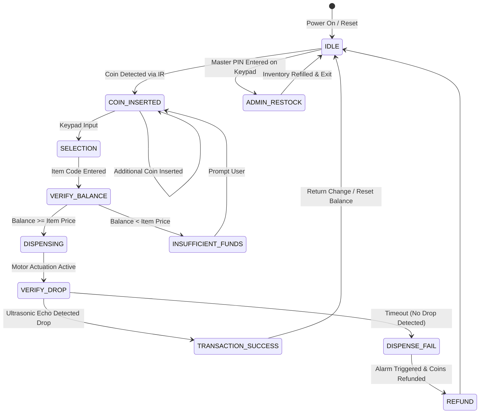

# ⚡ STM32F103C8T6 Embedded Systems & FreeRTOS Suite

[-002B49.svg?logo=stmicroelectronics&logoColor=white)](https://www.st.com/en/microcontrollers-microprocessors/stm32f103c8.html)
[](https://developer.arm.com/Processors/Cortex-M3)
[](https://www.freertos.org/)
[](https://www.st.com/en/development-tools/stm32cubeide.html)
[](LICENSE)

A production-grade collection of bare-metal and real-time operating system (**FreeRTOS**) embedded applications engineered for the **STM32F103C8T6 (ARM Cortex-M3 "Blue Pill")** microcontroller.

The flagship implementation in this suite is an industrial-grade **RTOS-Driven Automated Vending Machine System** featuring 8 synchronized concurrent tasks, event-driven state machines, ultrasonic drop-verification feedback, and complete hardware peripheral integration.

---

## 🌟 Flagship Project: FreeRTOS Smart Vending Machine

The **RTOS Vending Machine** is architected around the CMSIS-RTOS / FreeRTOS kernel on STM32, coordinating multiple physical peripherals concurrently through non-blocking queues, task notifications, and semaphore synchronization.

```text
                               +----------------------------------------+
                               |        STM32F103C8T6 (FreeRTOS)        |
                               +----------------------------------------+
                                                   |
      [4x4 Keypad]  ---------> | keypadTask        | Priority: Normal   |
      [IR Coin Slot] --------> | coinTask (EXTI)   | Priority: Normal   |
                               |                   |                    |
                               | ===> controlTask  | Priority: High     | <--- Central FSM Engine
                               |      (State Mach) |                    |
                               |                   |                    |
      [L293D Motors] <-------- | motorTask         | Priority: Normal   |
      [HC-SR04 Sensor] ------> | ultrasonicTask    | Priority: Normal   | <--- Drop Verification
      [16x2 I2C LCD] <-------- | displayTask       | Priority: Normal   |
      [PWM Buzzer]   <-------- | buzzerTask        | Priority: Normal   |
                               +----------------------------------------+
```

### 🧠 FreeRTOS Multitasking Architecture

| Thread / Task | Stack Size | Priority | Responsibility |
| :--- | :---: | :---: | :--- |
| `controlTask` | 512 Bytes | **AboveNormal** | Central finite state machine supervisor: validates balances, manages pricing, checks inventory, and controls restock access. |
| `keypadTask` | 256 Bytes | **Normal** | 4×4 Matrix keypad debounce, key detection, and command queueing. |
| `coinTask` | 128 Bytes | **Normal** | Interrupt-driven IR beam-break coin slot sensor for anti-counterfeit credit counting. |
| `motorTask` | 128 Bytes | **Normal** | H-Bridge (L293D) motor actuation driving dispensing spirals/solenoids. |
| `ultrasonicTask` | 256 Bytes | **Normal** | HC-SR04 ultrasonic pulse-echo distance measurement verifying physical product delivery into chute. |
| `displayTask` | 256 Bytes | **Normal** | I2C LCD 16×2 refresh pipeline rendering live balance, selection, and administrative menus. |
| `buzzerTask` | 128 Bytes | **Normal** | Acoustic feedback generation for key clicks, coin credits, transaction approvals, and errors. |

---

## 📊 System State Machine Flow



---

## 🔌 Hardware Wiring & Peripheral Pinout

### 1. Vending Machine Core Pinout (Blue Pill)
| Peripheral | STM32F103 Pin | Mode / Configuration | Notes |
| :--- | :--- | :--- | :--- |
| **I2C1 SDA** | `PB7` | Alternate Function Open-Drain | Connects to PCF8574 I2C LCD Adapter |
| **I2C1 SCL** | `PB6` | Alternate Function Open-Drain | I2C Clock (100 kHz Standard Mode) |
| **Keypad Rows** | `PA0, PA1, PA2, PA3` | GPIO Output Push-Pull | 4x4 Matrix scanning lines |
| **Keypad Cols** | `PA4, PA5, PA6, PA7` | GPIO Input with Pull-Down | Key sensing inputs |
| **Coin IR Sensor** | `PB0` | GPIO Input with EXTI Interrupt | Falling-edge beam break detection |
| **Ultrasonic TRIG** | `PB1` | GPIO Output Push-Pull | 10 µs trigger pulse |
| **Ultrasonic ECHO** | `PB10` | GPIO Input / Timer Input Capture | Echo pulse width measurement |
| **Motor IN1, IN2** | `PB12, PB13` | GPIO Output Push-Pull | L293D Channel A Dispenser Motor |
| **Motor IN3, IN4** | `PB14, PB15` | GPIO Output Push-Pull | L293D Channel B Dispenser Motor |
| **Buzzer** | `PA8` | TIM1_CH1 PWM / GPIO | Tone frequency generator |
| **UART1 TX** | `PA9` | USART1 (115200 baud) | Debug logging output |
| **UART1 RX** | `PA10` | USART1 (115200 baud) | System control & diagnostics |

---

## 📁 Repository Directory Structure

```text
STM32F103C8T6_PROJECTS/
├── RTOS_VENDING_MACHINE/        # Flagship FreeRTOS 8-task smart vending machine
│   ├── Core/Src/main.c         # State machine, FreeRTOS task handles & scheduling
│   ├── Core/Inc/               # Header definitions, pin mappings, queue structures
│   └── RTOS_VENDING_MACHINE.ioc# STM32CubeMX hardware initialization configuration
├── LCD16X2_I2C/                 # Standalone PCF8574-based I2C 16x2 character LCD driver
├── keypad_4x4/                  # Matrix keypad driver with software debounce
├── IRSensor/                    # Digital and interrupt-based IR proximity detection
├── IR_Lcd16x2_I2c/              # Integrated IR sensor counter with live LCD readout
├── Ultrasonic_I2C_16x2LCD/      # HC-SR04 sonar distance measuring station
├── L293d_4channel_UartSerial/   # 4-channel bidirectional motor controller via UART
├── L29d_motor_UART/             # Serial command protocol for DC motor speed/direction
├── pwm_UartSerial/              # Hardware Timer PWM generation with UART duty-cycle tuning
├── pwn_button/                  # Push-button adjustable hardware PWM brightness/speed controller
├── Rtos_Led/                    # Dual-thread FreeRTOS task switching demonstration
├── uart_serial_test/            # USART communication, circular buffers, and loopback testing
├── button/ & blink/             # Fundamental GPIO input/output baseline projects
└── STM32_VENDING MACHINE.pdf    # Full engineering project report and schematics
```

---

## 🛠️ Build & Flash Instructions

### Using STM32CubeIDE:
1. Open **STM32CubeIDE** (or Keil MDK-ARM).
2. Click **File** $\rightarrow$ **Open Projects from File System...** and browse to `RTOS_VENDING_MACHINE` (or any sub-project).
3. Connect an **ST-LINK V2** programmer to the Blue Pill:
   - `SWDIO` $\rightarrow$ `SWDIO`
   - `SWCLK` $\rightarrow$ `SWCLK`
   - `GND` $\rightarrow$ `GND`
   - `3.3V` $\rightarrow$ `3.3V`
4. Click **Project** $\rightarrow$ **Build Project** (`Ctrl + B`).
5. Click **Run** $\rightarrow$ **Debug** or **Run** (`F11`) to flash the firmware into Flash memory.

---

## 📄 License

This repository is distributed under the [MIT License](LICENSE).
